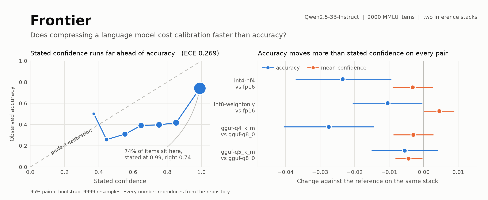

# Frontier

<picture>
  <source media="(prefers-color-scheme: dark)" srcset="docs/assets/frontier-dark.png">
  
</picture>

A benchmark for whether compression degrades a model's calibration faster than its
accuracy, and whether that holds across compression families (post-training
quantization, quantization-aware training, distillation). Calibration (ECE, Brier,
reliability diagrams) is the contribution; accuracy, latency, and memory are the
reference axes. Single 16GB GPU, roughly 20 GPU-hours, every path also runnable on a
CPU laptop (`docs/architecture.md`).

Models that ship to a phone or a cost-controlled endpoint are usually quantized or
distilled first, and the check that authorizes the swap is an accuracy comparison
against the uncompressed model. If calibration degrades faster than accuracy, that
check passes while the deployed model's confidence has stopped tracking its
correctness, and every abstention threshold tuned against the original is set wrong.

This project is funded by a [Rapid Grant](https://bluedot.org/grants/rapid) from
BlueDot Impact.

## Status

All 14,042 MMLU test questions, Qwen2.5-3B-Instruct and Qwen2.5-0.5B-Instruct. Each arm is
paired with its own model's fp16 reference; multi-run arms resample runs and questions.
Excess damage is d ECE + d accuracy, the ECE rise beyond the accuracy lost; damage is claimed
when its 95% interval lies above zero.

| arm | runs | d accuracy | d ECE | excess damage | d AUROC | residual gap after one temperature |
|---|---|---|---|---|---|---|
| int4 GPTQ, 3B | 3 calibration draws | -0.015 | +0.016 | +0.0009 [-0.0014, +0.0032] | -0.006 | +0.003 [-0.004, +0.009] |
| int4 AWQ, 3B | 3 calibration draws | -0.021 | +0.019 | -0.0022 [-0.0066, +0.0026] | -0.005 | +0.013 [+0.004, +0.020] |
| 3-bit QAT + LoRA, 3B | 3 training runs | -0.087 | -0.054 | withheld | -0.072 | +0.025 [+0.008, +0.037] |
| 3-bit full QAT, 0.5B | 3 training runs | -0.149 | -0.087 | withheld | -0.101 | -0.014 [-0.026, -0.004] |
| distill, soft labels, 0.5B | 3 training runs | -0.000 | -0.055 | -0.055 [-0.059, -0.051] | +0.003 | -0.005 [-0.014, +0.004] |
| distill, hard labels, 0.5B | 3 training runs | -0.002 | +0.005 | +0.003 [-0.004, +0.009] | +0.003 | -0.003 [-0.013, +0.007] |
| distill, corpus control, 0.5B | 3 training runs | -0.083 | -0.021 | withheld | -0.040 | -0.004 [-0.018, +0.007] |

- The fp16 3B reference scores 0.656, near Qwen's published figure, at mean confidence
  0.919: overconfident, ECE 0.263.
- int4 GPTQ and AWQ cost 1.5 and 2.1 points of accuracy and leave confidence where it was, so
  ECE rises by the accuracy lost. AWQ keeps a residual after one fitted temperature.
- The earlier "ECE degrades about twice as fast as accuracy" reading compared relative
  changes. With confidence fixed that ratio equals the reference's accuracy over its ECE
  (2.5), so it measures the reference.
- 3-bit PTQ takes both models to near chance (3B 0.259, 0.5B 0.296).
- 3B QAT recovers 78% of the accuracy PTQ lost and turns underconfident (confidence 0.36 at
  accuracy 0.57). Excess damage is withheld wherever the error changes sign. Scored one option
  order at a time the QAT model is close to calibrated but answers A 59% of the time;
  averaging over the four orders raises its accuracy and leaves its confidence flat. AUROC and
  the residual after one temperature both record damage.
- Soft-label distillation lowers the 0.5B's ECE at unchanged accuracy; one temperature gives
  the original 0.5B the same residual.
- Not built: the chain-of-thought arm. The bitsandbytes and llama.cpp arms are single
  2,000-question rows.
- Test suite: 692 passing, 22 gated skips, under ruff and mypy strict.

## Setup

`uv`-managed, Python 3.11 pinned.

```bash
uv sync                      # base plus dev tools (ruff, mypy, pytest); CPU only
uv run pytest                # runs offline
uv sync --group oracles      # calibration-metric oracle libs (torchmetrics, netcal)
uv sync --group hf           # Track A HF backend (torch, transformers, bitsandbytes)
```

The Track B serving and quantization stack (vLLM, llmcompressor, torchao,
llama-cpp-python) pins against the real CUDA build and conflicts with the `hf` group's
transformers, so it installs on the pod by hand (`docker/README.md`).

## Running

A run is one variant crossed with one eval profile, and appends one result row. `mode`
is a config field: `smoke` pins a tiny model and a 50-item CPU slice, `full` uses the
real models and eval sets on the pod.

```bash
# CPU smoke (downloads SmolLM2-135M)
FRONTIER_LIVE_MODELS=1 uv run --group hf \
  frontier run --config configs/variants/fp16.yaml --mode smoke

# full run on the pod
uv run --group hf frontier run --config configs/variants/int4-nf4.yaml --mode full

# frontier chart, reliability gallery, ECE-vs-bins sweep
uv run frontier plot --results results --plots-dir plots
```

| command | further flags |
|---|---|
| `frontier run` | `--eval` (a profile under `configs/evals/`), `--skip-latency`, `--skip-predictions` |
| `frontier plot` | `--x memory\|latency\|cost_inv`, `--color-by family\|track`, `--figures` |
| `frontier-quantize` | pod-only; `run` writes one checkpoint per seed (GPTQ, AWQ, W8A8, GGUF, QAT, distilled students), `cache` builds a distill variant's teacher cache |

## Layout

```
configs/        one YAML per variant and per eval profile
  schema/       JSON Schema the configs validate against
  variants/     the compression matrix as data (fp16, int4-nf4, int4-gptq, ...)
  evals/        task profiles: primary-mmlu, secondary-arc, reasoning-cot
src/frontier/   metrics, eval, backends, quantize, distill, latency, io, analysis
scripts/pod/    bootstrap, run a job, mirror results back, sync
tests/          unit tests; the calibration maths carry the heaviest coverage
results/        the result store (jsonl plus parquet); git-ignored
plots/          figures written by frontier plot; git-ignored
reports/        the technical writeup and its figures
```

| doc | covers |
|---|---|
| `docs/architecture.md` | two-track design, variant matrix, measurement rules, toolchain |
| `docs/results_schema.md` | the result-row schema |
| `docker/README.md` | the pod image, its version pins, and RunPod bring-up |
| `scripts/pod/README.md` | the SSH job runner |
| `tests/README.md` | what is covered and what is gated |
